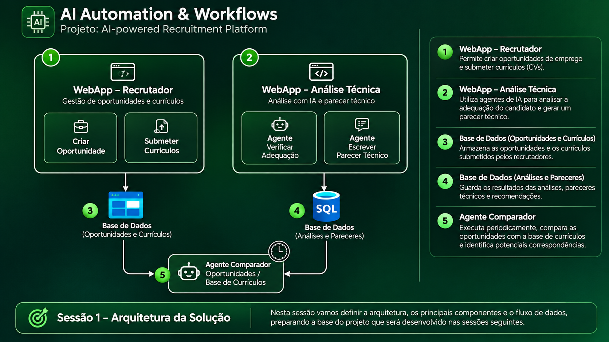

# 🏗️ Session 01 — Solution Architecture

## 🎯 Objetivo da Sessão

Nesta sessão vamos definir a arquitetura da solução **AI-powered Recruitment Platform**, um sistema de recrutamento inteligente que utiliza Inteligência Artificial para apoiar a análise de currículos, avaliar a adequação de candidatos a oportunidades de emprego e produzir pareceres técnicos.

O objetivo é compreender como diferentes aplicações, serviços, agentes de AI, bases de dados e workflows podem trabalhar em conjunto para implementar uma solução de automação inteligente.

Ao longo das próximas sessões, esta arquitetura será progressivamente implementada e enriquecida.

---

## 🧩 1. Visão Geral da Solução

A solução será composta por três elementos principais:

1. **WebApp – Recrutador:** aplicação responsável pela gestão de oportunidades e submissão de currículos.
2. **WebApp – Análise Técnica:** aplicação responsável pela análise dos candidatos, utilizando agentes de Inteligência Artificial.
3. **Agente Comparador:** componente automatizado responsável por identificar correspondências entre oportunidades disponíveis e currículos existentes.

### Arquitetura de Referência

### Componentes da Arquitetura

#### 1. WebApp – Recrutador

Aplicação utilizada pelos responsáveis pelo processo de recrutamento.

Principais funcionalidades:

- Criar e gerir oportunidades de emprego.
- Definir requisitos técnicos e competências desejadas.
- Submeter currículos (CVs).
- Consultar oportunidades e candidatos registados.

#### 2. WebApp – Análise Técnica

Aplicação responsável por disponibilizar os resultados das análises efetuadas pelos agentes de AI.

É composta por dois agentes especializados:

**Agente – Verificar Adequação**

- Recebe os dados de uma oportunidade e o respetivo currículo.
- Analisa competências técnicas e experiência profissional.
- Compara os requisitos da oportunidade com o perfil do candidato.
- Produz uma avaliação estruturada da adequação.

**Agente – Escrever Parecer Técnico**

- Recebe os resultados da análise de adequação.
- Consolida evidências relevantes.
- Identifica pontos fortes e lacunas técnicas.
- Produz um parecer técnico estruturado.

#### 3. Base de Dados – Oportunidades e Currículos

Responsável pelo armazenamento da informação submetida através da WebApp de recrutamento.

Principais entidades:

- Opportunities
- Candidates
- Resumes
- RequiredSkills

#### 4. Base de Dados – Análises e Pareceres

Responsável pela persistência dos resultados produzidos pelos agentes de AI.

Principais entidades:

- CandidateAssessments
- TechnicalReports
- SkillEvaluations
- MatchingResults

#### 5. Agente Comparador – Oportunidades / Base de Currículos

Componente executado periodicamente, responsável por comparar as oportunidades disponíveis com os currículos existentes.

Principais responsabilidades:

- Consultar oportunidades disponíveis.
- Recuperar os currículos registados.
- Identificar potenciais correspondências.
- Avaliar a adequação dos candidatos às oportunidades.
- Registar os resultados das comparações.
- Disponibilizar recomendações para análise humana.

A execução deste componente será iniciada através de um mecanismo de agendamento (*scheduled trigger*).

---

## 🔄 2. Fluxos de Processamento

### Fluxo A — Submissão de Currículos

1. O recrutador cria uma oportunidade.
2. O recrutador submete um ou vários currículos.
3. A aplicação valida e regista a informação.
4. Os documentos e respetivos metadados ficam disponíveis para processamento.

### Fluxo B — Análise Técnica

1. Uma oportunidade e um currículo são selecionados para análise.
2. O Agente de Verificar Adequação recebe os dados necessários.
3. O modelo de AI analisa os requisitos e as competências identificadas.
4. O resultado é devolvido num formato estruturado.
5. O Agente de Escrever Parecer Técnico recebe o resultado.
6. É produzido um parecer técnico.
7. Os resultados são persistidos na base de dados.

### Fluxo C — Comparação Automatizada

1. Um trigger agendado inicia a execução do Agente Comparador.
2. O agente consulta as oportunidades disponíveis.
3. Recupera a base de currículos.
4. Compara os requisitos das oportunidades com os perfis dos candidatos.
5. Identifica potenciais correspondências.
6. Regista os resultados e disponibiliza recomendações.

---

## 🧠 3. Conceitos de Arquitetura Aplicados

Durante a implementação vamos explorar os seguintes conceitos:

### AI Agents

Agentes especializados em tarefas específicas, com responsabilidades bem definidas.

### Workflow Orchestration

Coordenação da execução dos diferentes componentes e agentes.

### API Integration

Comunicação entre aplicações, serviços e modelos de Inteligência Artificial.

### Event-Driven Architecture

Utilização de eventos para iniciar determinados processos de forma desacoplada.

### Scheduled Workflows

Execução periódica de tarefas automatizadas.

### Structured Outputs

Utilização de respostas estruturadas para permitir que os resultados produzidos pelos modelos sejam consumidos por aplicações.

### Human-in-the-loop

A intervenção humana continua presente no processo, especialmente na validação das recomendações e nas decisões finais de recrutamento.

---

## 🔐 4. Considerações Arquiteturais

A solução deverá considerar desde o início:

- Separação de responsabilidades entre aplicações e agentes.
- Segurança no acesso aos dados e serviços.
- Proteção de currículos e dados pessoais.
- Gestão segura de credenciais e configurações.
- Validação das respostas produzidas pelos modelos.
- Logging e rastreabilidade das execuções.
- Controlo de custos associados à utilização dos modelos.
- Supervisão humana das recomendações.

**Nota:** A avaliação produzida pela IA é um mecanismo de apoio à decisão. Não deverá constituir uma decisão automática de contratação ou rejeição de candidatos.

---

## 🛠️ 5. Hands-on — Primeiros Passos

Durante esta sessão vamos preparar a base do projeto.

### Exercício 1 — Análise da Arquitetura

- Identificar os componentes principais.
- Compreender as responsabilidades de cada aplicação.
- Identificar os agentes necessários.
- Desenhar os principais fluxos de informação.

### Exercício 2 — Definição dos Contratos

Identificar os principais objetos de negócio e os dados necessários para a comunicação entre componentes.

Exemplos:

- JobOpportunity
- Candidate
- Resume
- CandidateAssessment
- TechnicalReport

### Exercício 3 — Preparação do Ambiente

- Criar a estrutura inicial da solução.
- Preparar o repositório Git.
- Definir a organização dos projetos.
- Identificar os serviços externos necessários.

### Exercício 4 — Definição dos Workflows

Identificar quais os processos que serão:

- Iniciados por utilizadores.
- Executados através de eventos.
- Orquestrados por agentes de AI.
- Executados periodicamente.

---

## 📌 6. Resultado Esperado

No final desta sessão, os participantes deverão compreender a arquitetura global da solução, os principais componentes e as respetivas responsabilidades.

Deverão também ter uma visão clara de como os modelos de AI serão integrados nas aplicações e de como os diferentes workflows serão orquestrados.

A arquitetura definida nesta sessão servirá como referência para a implementação progressiva da plataforma nas sessões seguintes.

---

## 🔗 Próxima Sessão

**Session 02 — AI Model Integration**

Vamos começar a integrar modelos de Inteligência Artificial na solução, explorando Azure AI / Azure OpenAI, prompting, Structured Outputs, Function Calling e integração com aplicações .NET.