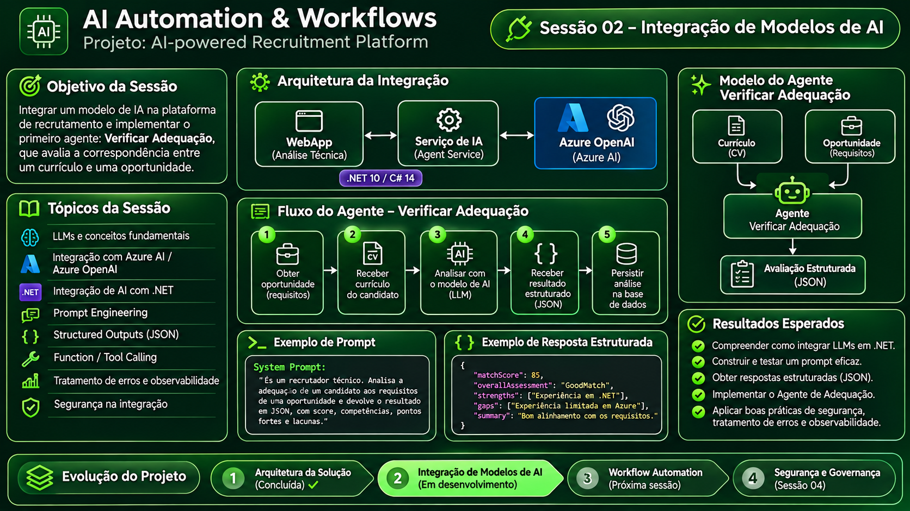

# 🔌 Session 02 --- AI Model Integration

## 🎯 Objetivo da Sessão

Nesta sessão vamos explorar como integrar modelos de Inteligência
Artificial em aplicações e serviços, utilizando APIs e plataformas como
**Azure AI / Azure OpenAI**.

O objetivo principal será implementar o primeiro agente inteligente da
**AI-powered Recruitment Platform**, responsável por analisar a
adequação de um candidato a uma determinada oportunidade de emprego.

Durante a sessão vamos abordar conceitos fundamentais de integração com
Large Language Models (LLMs), técnicas de prompting, Structured Outputs
e Function/Tool Calling.

A abordagem será essencialmente prática, utilizando .NET para
implementar a comunicação entre a aplicação e os modelos de AI.

## 🖼️ Visualização da Sessão


------------------------------------------------------------------------

## 🧠 1. Large Language Models (LLMs)

Antes de integrar um modelo de Inteligência Artificial numa aplicação, é
importante compreender os principais conceitos envolvidos.

### Conceitos Fundamentais

-   O que são Large Language Models (LLMs).
-   Como funcionam os modelos generativos.
-   Tokens e contexto.
-   Context Window.
-   System Prompts e User Prompts.
-   Temperature e parâmetros de geração.
-   Input Tokens vs. Output Tokens.
-   Modelos de AI e respetivas capacidades.

### Integração de Modelos

Explorar diferentes formas de consumir modelos de Inteligência
Artificial:

-   Consumo de modelos através de APIs REST.
-   Azure AI e Azure OpenAI.
-   Autenticação e configuração de endpoints.
-   Gestão de deployments e modelos.
-   Requisições e respostas.
-   Limites de utilização e Rate Limiting.

------------------------------------------------------------------------

## 🔌 2. Integração de AI com .NET

Vamos explorar como integrar modelos de Inteligência Artificial numa
aplicação desenvolvida em .NET.

### Principais conceitos

-   Consumo de serviços de AI através de aplicações .NET.
-   Utilização de clientes HTTP e SDKs.
-   Configuração de endpoints e credenciais.
-   Gestão de configurações através de Dependency Injection.
-   Separação entre lógica de negócio e integração com modelos.
-   Implementação de serviços especializados para comunicação com LLMs.

### Exemplo de arquitetura

``` text
Application
    |
    v
AI Service Interface
    |
    v
AI Service Implementation
    |
    v
LLM Provider
    |
    v
Azure OpenAI / Azure AI
```

A aplicação não deverá depender diretamente dos detalhes de
implementação de um fornecedor específico de modelos.

Esta separação permite substituir ou adicionar providers sem comprometer
a lógica principal da aplicação.

### 🖼️ AI Model Integration


------------------------------------------------------------------------

## ✍️ 3. Prompt Engineering

Um dos elementos fundamentais na integração de modelos de AI é a
construção de instruções eficazes.

### Conteúdos

-   O que é Prompt Engineering.
-   System Prompt vs. User Prompt.
-   Definição de contexto e responsabilidades.
-   Instruções e restrições.
-   Few-shot Prompting.
-   Contextualização de informação.
-   Separação entre instruções e dados fornecidos pelo utilizador.
-   Técnicas para reduzir respostas inconsistentes.
-   Limitações e alucinações dos modelos.

### Aplicação prática

Vamos construir um prompt para um agente especializado em recrutamento
técnico.

O agente deverá receber:

-   Descrição de uma oportunidade.
-   Requisitos técnicos.
-   Informação extraída de um currículo.

Com base nesses dados, deverá avaliar a correspondência entre o perfil
do candidato e os requisitos da oportunidade.

------------------------------------------------------------------------

## 📦 4. Structured Outputs

Um dos desafios na integração de LLMs é garantir que as respostas podem
ser consumidas de forma previsível pelas aplicações.

Vamos explorar técnicas para obter resultados estruturados.

### Conteúdos

-   Diferenças entre respostas em texto livre e respostas estruturadas.
-   JSON Outputs.
-   Definição de schemas.
-   Validação de respostas.
-   Tipagem e desserialização em C#.
-   Tratamento de respostas inválidas.
-   Structured Outputs vs. JSON Mode.

### Exemplo de resultado esperado

O agente de adequação deverá produzir uma resposta semelhante a:

``` json
{
  "candidateId": "CAND-001",
  "opportunityId": "JOB-001",
  "overallAssessment": "GoodMatch",
  "matchScore": 85,
  "skillsEvaluation": [
    {
      "skill": "C#",
      "required": true,
      "candidateLevel": "Advanced",
      "assessment": "MeetsRequirement"
    },
    {
      "skill": "Azure",
      "required": true,
      "candidateLevel": "Intermediate",
      "assessment": "PartiallyMeetsRequirement"
    }
  ],
  "strengths": [
    "Strong .NET development experience",
    "Experience with distributed systems"
  ],
  "gaps": [
    "Limited experience with Azure AI"
  ],
  "summary": "The candidate demonstrates strong alignment with the technical requirements."
}
```

O resultado deverá ser convertido para um objeto C# e validado antes de
ser utilizado pela aplicação.

**Nota:** O matchScore será um indicador de apoio à análise, não uma
medida objetiva da qualidade profissional do candidato.

------------------------------------------------------------------------

## 🛠️ 5. Function Calling & Tool Calling

Os modelos de AI podem utilizar ferramentas externas para consultar
informação ou executar operações disponibilizadas pela aplicação.

Vamos explorar como permitir que um modelo interaja com funcionalidades
externas de forma controlada.

### Conteúdos

-   O que é Function Calling.
-   O que é Tool Calling.
-   Definição de ferramentas disponíveis.
-   Descrição e parâmetros das ferramentas.
-   Execução de ferramentas pela aplicação.
-   Devolução dos resultados ao modelo.
-   Controlo e validação das operações.
-   Diferença entre uma chamada de ferramenta e uma execução autónoma.

### Exemplo prático

Imagine que o agente precisa de obter informação adicional sobre uma
oportunidade.

Poderá utilizar uma ferramenta disponibilizada pela aplicação:

``` text
Tool: GetJobOpportunity

Parameters:
- opportunityId

Returns:
- Job title
- Description
- Required skills
- Experience level
```

O modelo identifica a necessidade de utilizar a ferramenta, mas a
execução efetiva é controlada pela aplicação.

Este mecanismo permite construir agentes capazes de interagir com
sistemas externos sem lhes conceder acesso indiscriminado à
infraestrutura.

------------------------------------------------------------------------

## 🤖 6. Hands-on --- Implementação do Agente de Adequação

Nesta parte da sessão vamos implementar o primeiro agente da nossa
plataforma de recrutamento.

### Objetivo

Construir um agente de AI capaz de analisar um currículo e verificar a
sua adequação a uma oportunidade de emprego.

### 🖼️ Agent Architecture



### Fluxo de processamento

1.  Receber o identificador da oportunidade.
2.  Recuperar os requisitos técnicos da oportunidade.
3.  Receber o conteúdo do currículo previamente extraído.
4.  Construir o contexto e as instruções do agente.
5.  Enviar a solicitação ao modelo de AI.
6.  Receber a resposta estruturada.
7.  Validar e converter o resultado para um objeto C#.
8.  Disponibilizar o resultado para os restantes componentes da
    aplicação.

### Responsabilidades do agente

O agente deverá:

-   Identificar competências técnicas presentes no currículo.
-   Comparar as competências identificadas com os requisitos da
    oportunidade.
-   Avaliar a experiência profissional relevante.
-   Identificar requisitos cumpridos e não cumpridos.
-   Apresentar evidências que sustentem a análise.
-   Produzir uma avaliação estruturada.

### Exemplo de interação

**Input:**

``` text
Opportunity:
Senior .NET Developer

Required Skills:
- C#
- .NET
- Azure
- SQL Server
- Microservices

Candidate Resume:
Software Engineer with 8 years of experience
in C# and .NET development.
Experience with SQL Server and distributed systems.
Basic exposure to Azure services.
```

**Expected Output:**

Uma avaliação estruturada contendo:

-   Competências identificadas.
-   Requisitos correspondentes.
-   Lacunas técnicas.
-   Evidências encontradas.
-   Resumo da avaliação.

A análise deverá considerar exclusivamente evidências presentes nos
dados fornecidos, distinguindo informação não encontrada de competências
efetivamente ausentes.

------------------------------------------------------------------------

## ⚠️ 7. Tratamento de Erros e Observabilidade

Uma integração com modelos de AI precisa de considerar cenários de falha
e comportamentos inesperados.

### Conteúdos

-   Timeout e falhas de comunicação.
-   Rate Limiting.
-   Retry Policies.
-   Tratamento de respostas inválidas.
-   Validação de Structured Outputs.
-   Gestão de exceções.
-   Logging das interações.
-   Monitorização de utilização de tokens.
-   Medição de latência e custos.
-   Correlação de requests.

### Boas práticas

-   Nunca assumir que a resposta do modelo é sempre válida.
-   Validar os dados antes de persistir resultados.
-   Implementar limites de execução.
-   Evitar exposição de informações sensíveis nos logs.
-   Monitorizar consumo e custos.
-   Manter rastreabilidade das execuções.

------------------------------------------------------------------------

## 🔐 8. Segurança na Integração

Algumas preocupações fundamentais na utilização de modelos de AI:

-   Gestão de API Keys e Secrets.
-   Utilização de variáveis de ambiente.
-   Azure Key Vault.
-   Managed Identities.
-   Proteção de dados pessoais.
-   Prompt Injection.
-   Separação entre instruções e conteúdo não confiável.
-   Princípio do menor privilégio.

No contexto da plataforma de recrutamento, os currículos devem ser
considerados conteúdo não confiável. Instruções eventualmente presentes
nos documentos não podem substituir as instruções definidas pela
aplicação.

------------------------------------------------------------------------

## 📌 9. Resultado Esperado

No final desta sessão, os participantes deverão ter compreendido como
integrar modelos de Inteligência Artificial em aplicações .NET e como
estruturar interações com LLMs.

O principal resultado prático será a implementação do primeiro agente da
plataforma:

**Agente -- Verificar Adequação**

Este componente será responsável por analisar os requisitos de uma
oportunidade e compará-los com as informações disponíveis no currículo
de um candidato.

A implementação servirá de base para a próxima sessão, onde vamos
explorar a construção de workflows inteligentes, orquestração de agentes
e integração entre diferentes componentes.

------------------------------------------------------------------------

## 🔗 Próxima Sessão

**Session 03 --- Intelligent Workflow Automation**

Vamos evoluir a plataforma através da implementação de workflows
inteligentes, explorando orquestração, integração entre serviços,
execução de tarefas automatizadas e construção do Agente Comparador de
Oportunidades e Currículos.
