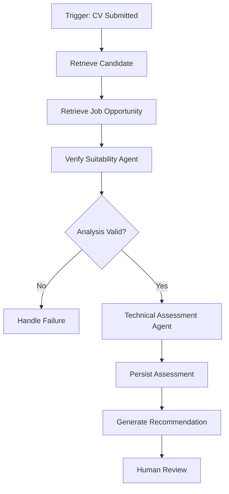
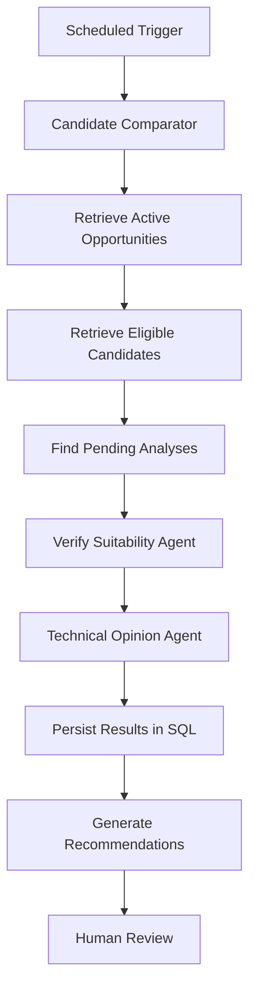
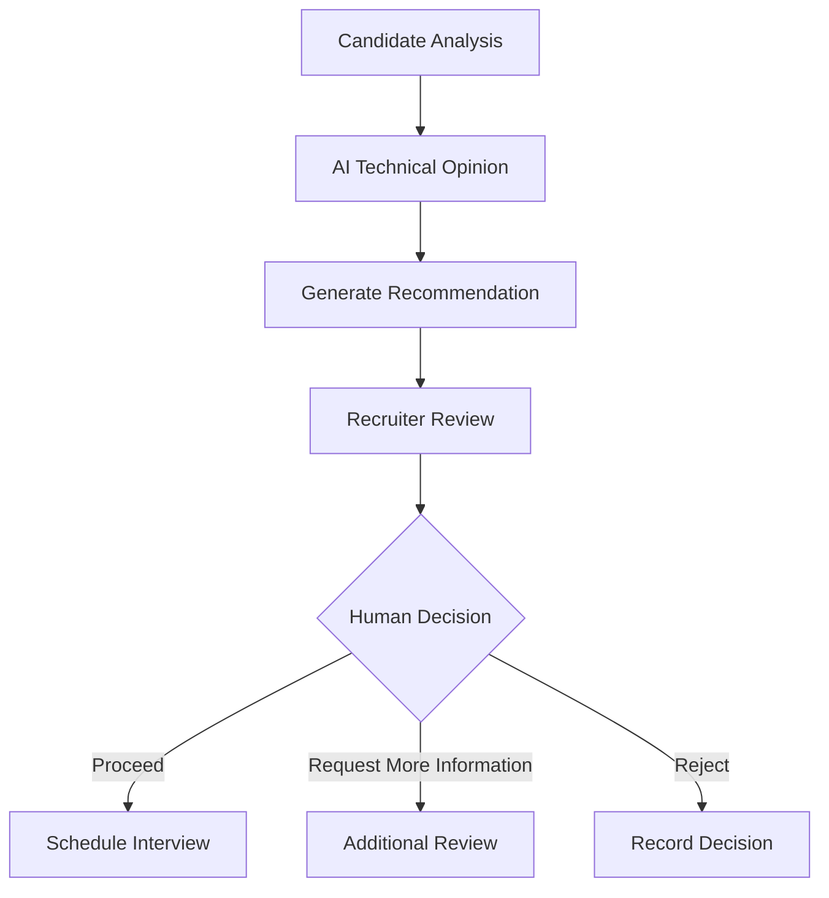

# ⚙️ Session 03 — Intelligent Workflow Automation

## 🎯 Objetivo da Sessão

Nesta sessão vamos explorar como construir workflows inteligentes capazes de coordenar diferentes agentes de Inteligência Artificial, serviços e sistemas empresariais.

O objetivo principal será evoluir a **AI-powered Recruitment Platform**, desenvolvida nas sessões anteriores, introduzindo mecanismos de orquestração, automatização de processos e execução periódica de tarefas.

Vamos implementar dois novos componentes:

1. **Agente — Parecer Técnico:** responsável por transformar os resultados da análise de adequação num parecer técnico estruturado.
2. **Agente Comparador — Oportunidades e Currículos:** responsável por executar comparações periódicas entre oportunidades disponíveis e candidatos, coordenando os agentes existentes.

Durante a sessão vamos explorar workflows determinísticos, workflows orientados por AI, triggers, actions, conditions, agendamento de tarefas, integração entre serviços e Human-in-the-loop.

A abordagem será essencialmente prática, utilizando .NET 10, Azure AI / Azure OpenAI e Azure SQL.

---

## 🖼️ Visualização da Sessão


---

# 🧠 1. Intelligent Workflows — Conceitos e Arquitetura

## O que é um AI-powered Workflow?

Um workflow inteligente é um conjunto de operações organizadas para executar um determinado processo, utilizando regras de negócio, serviços externos e, quando necessário, modelos de Inteligência Artificial.

Ao contrário de uma integração simples com um modelo de AI, um workflow permite coordenar várias operações e tomar decisões com base nos resultados obtidos.

### Workflow tradicional vs. AI-powered Workflow

| Característica | Workflow tradicional | AI-powered Workflow |
|---|---|---|
| Execução | Regras predefinidas | Regras + AI |
| Decisões | Condições determinísticas | Condições e interpretação contextual |
| Dados | Estruturados | Estruturados e não estruturados |
| Processamento | Operações previsíveis | Operações com resultados probabilísticos |
| Integração | APIs e serviços | APIs, serviços e agentes de AI |
| Resultado | Ação predefinida | Ação ou recomendação contextual |

### Exemplo: Processo tradicional

```text
Receive Application
       |
       v
Validate Candidate
       |
       v
Check Required Skills
       |
       v
Apply Business Rules
       |
       v
Generate Result
```

### Exemplo: AI-powered Workflow

```text
Receive Application
       |
       v
Extract Candidate Information
       |
       v
AI Agent - Verify Suitability
       |
       v
AI Agent - Technical Assessment
       |
       v
Evaluate Results
       |
       v
Generate Recommendation
       |
       v
Human Review
```

A principal diferença está na capacidade de incorporar interpretação contextual e análise de informação não estruturada em diferentes etapas do processo.

**Importante:** nem todas as etapas precisam de AI. Validações, persistência, controlo de estados e regras de negócio devem continuar a ser determinísticos sempre que possível.

---

# 🔄 2. Workflow Orchestration

## Conceito de Orquestração

Orquestrar significa coordenar a execução de diferentes componentes para atingir um determinado objetivo.

Num sistema distribuído, um workflow pode envolver:

- Aplicações Web.
- APIs REST.
- Serviços de negócio.
- Agentes de AI.
- Bases de dados.
- Serviços cloud.
- Sistemas externos.

### Principais componentes

**Trigger**

Evento que inicia um workflow.

Exemplos:
- Submissão de um currículo.
- Criação de uma oportunidade.
- Alteração do estado de um candidato.
- Execução agendada.

**Action**

Operação executada durante o workflow.

Exemplos:
- Consultar uma oportunidade.
- Extrair informação de um currículo.
- Invocar um agente de AI.
- Persistir resultados.
- Enviar uma notificação.

**Condition**

Regra que determina o próximo passo.

Exemplos:
- A oportunidade está ativa?
- O candidato já foi analisado?
- Existem requisitos obrigatórios não cumpridos?
- O resultado necessita de revisão humana?

**Orchestration**

Coordenação das diferentes operações e respetivas dependências.

### Exemplo de workflow



## Deterministic vs. AI-driven Workflows

Existem duas abordagens que podem coexistir na mesma solução.

### Deterministic Workflow

A aplicação controla explicitamente todas as operações e decisões.

```csharp
if (candidate.IsActive && opportunity.IsActive)
{
    await ProcessApplicationAsync(candidate, opportunity);
}
```

O comportamento é previsível e controlado pela aplicação.

### AI-driven Workflow

Um agente de AI pode interpretar o contexto e selecionar uma ferramenta disponibilizada pela aplicação.

Por exemplo:

- Consultar os requisitos de uma oportunidade.
- Solicitar uma análise complementar.
- Recuperar informação adicional.
- Produzir uma recomendação.

A execução das ferramentas continua sob controlo da aplicação.

### Quando utilizar cada abordagem?

| Cenário | Abordagem recomendada |
|---|---|
| Validar dados obrigatórios | Determinística |
| Consultar uma base de dados | Determinística |
| Interpretar um currículo | AI |
| Comparar evidências técnicas | AI |
| Aplicar regras de negócio | Determinística |
| Produzir um parecer técnico | AI |
| Aprovar uma candidatura | Decisão humana |

---

# 🤖 3. Agent Orchestration — Technical Assessment

Na sessão anterior implementámos o agente:

**Verificar Adequação**

Este agente compara os requisitos de uma oportunidade com a informação extraída de um currículo.

Agora vamos introduzir um segundo agente.

## Agente — Parecer Técnico

O objetivo deste agente é transformar os resultados da análise anterior num relatório técnico estruturado.

### Responsabilidades

- Interpretar os resultados da análise de adequação.
- Consolidar competências identificadas.
- Analisar pontos fortes do candidato.
- Identificar lacunas técnicas.
- Avaliar riscos e limitações da evidência disponível.
- Produzir recomendações para uma entrevista técnica.
- Gerar um parecer técnico estruturado.

### Input

O agente deverá receber:

```json
{
  "candidateId": 101,
  "opportunityId": 25,
  "overallAssessment": "GoodMatch",
  "matchScore": 85,
  "skillsEvaluation": [
    {
      "skill": "C#",
      "required": true,
      "candidateLevel": "Advanced",
      "assessment": "MeetsRequirement"
    },
    {
      "skill": "Azure",
      "required": true,
      "candidateLevel": "Intermediate",
      "assessment": "PartiallyMeetsRequirement"
    }
  ],
  "strengths": [
    "Strong .NET development experience",
    "Experience with distributed systems"
  ],
  "gaps": [
    "Limited experience with Azure AI"
  ]
}
```

### Expected Output

O agente deverá produzir um parecer semelhante a:

```json
{
  "candidateId": 101,
  "opportunityId": 25,
  "technicalSummary": "Candidate demonstrates strong .NET experience.",
  "strengths": [
    "Advanced C# knowledge",
    "Experience with distributed systems"
  ],
  "technicalGaps": [
    "Limited evidence of Azure AI experience"
  ],
  "riskAssessment": [
    {
      "area": "Azure AI",
      "risk": "Medium",
      "reason": "Limited evidence available in the CV."
    }
  ],
  "interviewRecommendations": [
    "Evaluate Azure architecture knowledge",
    "Explore experience with distributed systems"
  ],
  "recommendation": "ProceedToTechnicalInterview",
  "requiresHumanReview": true
}
```

O resultado deverá ser estruturado e validado antes de ser persistido.

**Nota:** o parecer é uma ferramenta de apoio à decisão. Não deverá produzir decisões automáticas de contratação ou rejeição.

## Arquitetura do agente

```text
Technical Assessment Service
          |
          v
Suitability Analysis Result
          |
          v
Technical Opinion Agent
          |
          v
Azure OpenAI
          |
          v
Structured JSON Response
          |
          v
Validation
          |
          v
Technical Opinion Result
          |
          v
Azure SQL
```

## Implementação em .NET

Começamos por definir o contrato do agente.

```csharp
public interface ITechnicalOpinionAgent
{
    Task<TechnicalOpinion> GenerateAsync(
        SuitabilityAssessment assessment,
        CancellationToken cancellationToken = default);
}
```

Modelo de resposta:

```csharp
public sealed record TechnicalOpinion
{
    public int CandidateId { get; init; }

    public int OpportunityId { get; init; }

    public string TechnicalSummary { get; init; } = "";

    public List<string> Strengths { get; init; } = [];

    public List<string> TechnicalGaps { get; init; } = [];

    public List<string> InterviewRecommendations { get; init; } = [];

    public string Recommendation { get; init; } = "";

    public bool RequiresHumanReview { get; init; }
}
```

A implementação concreta deverá:

1. Receber o resultado do agente anterior.
2. Construir o contexto e o prompt.
3. Invocar o modelo de AI.
4. Solicitar uma resposta estruturada.
5. Validar o resultado.
6. Devolver o objeto `TechnicalOpinion`.

### Exercício

Implementar o agente de parecer técnico e integrá-lo com o agente de adequação da sessão anterior.

**Resultado esperado:** a plataforma deverá conseguir gerar uma análise de adequação e, posteriormente, um parecer técnico sem intervenção manual entre estas duas etapas.

---

# ⚙️ 4. Workflow Automation — Triggers, Actions & Scheduling

Agora que temos dois agentes, precisamos de os integrar num processo automatizado.

## Tipos de triggers

Um workflow pode ser iniciado de diferentes formas.

| Trigger | Exemplo |
|---|---|
| HTTP Trigger | Receção de uma candidatura através de uma API |
| Event Trigger | Criação de uma nova oportunidade |
| Database Trigger | Alteração de um registo |
| Scheduled Trigger | Execução diária ou horária |
| Manual Trigger | Ação iniciada pelo utilizador |

## Scheduled Workflows

Uma das funcionalidades importantes da nossa plataforma será a execução periódica de processos de comparação.

Por exemplo:

- Todos os dias às 08:00.
- A cada 30 minutos.
- Quando existirem novas oportunidades.
- Quando forem submetidos novos currículos.

O objetivo é evitar que o recrutador tenha de iniciar manualmente cada comparação.

## Ferramentas de automação

Existem várias formas de implementar workflows.

### Microsoft Power Automate


Plataforma low-code para automatizar processos e integrar diferentes serviços.

Principais conceitos:
- Cloud Flows.
- Automated Flows.
- Scheduled Flows.
- Connectors.
- Conditions.
- Approvals.

### Azure Functions


Permite executar código através de triggers e bindings.

Um Timer Trigger pode iniciar uma execução periódica de um workflow implementado em .NET.

### .NET Background Services

Permite executar tarefas em background dentro de aplicações e serviços .NET.

Exemplos:
- Processamento de filas.
- Execução periódica.
- Integração com APIs.
- Processamento de documentos.
- Orquestração de operações.

### Comparação

| Tecnologia | Utilização |
|---|---|
| Power Automate | Automação low-code e integrações empresariais |
| Azure Functions | Execução serverless orientada por triggers |
| .NET BackgroundService | Processamento em background com controlo através de código |
| Azure Logic Apps | Integração e orquestração de serviços |

A escolha depende da complexidade do workflow, dos requisitos operacionais e do ambiente de execução.

---

# 🔄 5. Hands-on — Agente Comparador de Oportunidades e Currículos

Nesta parte vamos implementar o segundo grande componente de automação da plataforma.

## Objetivo

Construir um agente comparador capaz de identificar correspondências entre oportunidades de emprego e candidatos disponíveis.

O processo deverá ser executado periodicamente, sem depender de uma ação manual do recrutador.

## Arquitetura proposta



## Fluxo de processamento

1. Iniciar o workflow através de um trigger agendado.
2. Recuperar as oportunidades ativas.
3. Identificar candidatos com currículos disponíveis.
4. Verificar quais os pares candidato/oportunidade ainda não analisados.
5. Invocar o agente de adequação quando necessário.
6. Invocar o agente de parecer técnico.
7. Persistir os resultados na base de dados.
8. Gerar recomendações.
9. Disponibilizar os resultados para revisão humana.

## Regras de negócio

O comparador deverá respeitar algumas regras:

- Apenas oportunidades ativas devem ser consideradas.
- Candidatos sem currículo não devem ser processados.
- Análises já concluídas não devem ser repetidas sem necessidade.
- Falhas de processamento devem poder ser recuperadas.
- Os resultados devem manter uma relação com o candidato e a oportunidade.
- Recomendações devem ser apresentadas para revisão humana.

## Implementação em .NET

Definir o contrato do comparador:

```csharp
public interface ICandidateComparator
{
    Task ExecuteAsync(
        CancellationToken cancellationToken = default);
}
```

Separar a lógica de negócio da execução agendada.

```csharp
public sealed class CandidateComparator(
    IOpportunityRepository opportunities,
    ICandidateRepository candidates,
    ISuitabilityAgent suitabilityAgent,
    ITechnicalOpinionAgent opinionAgent,
    IAssessmentRepository assessments)
    : ICandidateComparator
{
    public async Task ExecuteAsync(
        CancellationToken cancellationToken = default)
    {
        var activeOpportunities =
            await opportunities.GetActiveAsync(cancellationToken);

        foreach (var opportunity in activeOpportunities)
        {
            var eligibleCandidates =
                await candidates.GetEligibleAsync(
                    opportunity.Id,
                    cancellationToken);

            foreach (var candidate in eligibleCandidates)
            {
                var alreadyProcessed =
                    await assessments.ExistsAsync(
                        candidate.Id,
                        opportunity.Id,
                        cancellationToken);

                if (alreadyProcessed)
                    continue;

                // 1. Execute suitability analysis.
                // 2. Generate technical opinion.
                // 3. Persist the results.
                // 4. Make the recommendation available
                //    for human review.
            }
        }
    }
}
```

O exemplo apresenta a estrutura de orquestração. Os contratos dos repositórios e agentes deverão ser adaptados à implementação do projeto.

## Execução agendada com BackgroundService

Podemos utilizar um `BackgroundService` para executar o comparador periodicamente.

```csharp
public sealed class CandidateComparatorWorker(
    IServiceScopeFactory scopeFactory,
    ILogger<CandidateComparatorWorker> logger)
    : BackgroundService
{
    protected override async Task ExecuteAsync(
        CancellationToken stoppingToken)
    {
        using var timer = new PeriodicTimer(
            TimeSpan.FromHours(24));

        do
        {
            try
            {
                using var scope = scopeFactory.CreateScope();

                var comparator = scope.ServiceProvider
                    .GetRequiredService<ICandidateComparator>();

                await comparator.ExecuteAsync(stoppingToken);
            }
            catch (OperationCanceledException)
                when (stoppingToken.IsCancellationRequested)
            {
                break;
            }
            catch (Exception ex)
            {
                logger.LogError(
                    ex,
                    "Candidate comparison workflow failed.");
            }
        }
        while (await timer.WaitForNextTickAsync(stoppingToken));
    }
}
```

Registar o serviço:

```csharp
builder.Services.AddScoped<
    ICandidateComparator,
    CandidateComparator>();

builder.Services.AddHostedService<
    CandidateComparatorWorker>();
```

**Nota de arquitetura:** este exemplo executa o primeiro processamento imediatamente e depois aguarda intervalos de 24 horas. Num ambiente com múltiplas réplicas, é necessário implementar coordenação distribuída, idempotência e controlo de concorrência. Para uma execução com horário fixo, como todos os dias às 08:00, deverá ser utilizado um scheduler apropriado.

---

# 🗄️ 6. Persistence & Workflow State

Um workflow de produção precisa de manter o estado das operações.

Não basta executar os agentes: é necessário saber o que aconteceu, quando aconteceu e se a execução terminou com sucesso.

## Estados possíveis

```text
Pending
   |
   v
Processing
   |
   +------> Completed
   |
   +------> Failed
   |
   +------> RequiresHumanReview
```

## Modelo de dados sugerido

Além das entidades desenvolvidas anteriormente, podemos introduzir duas novas entidades:

### TechnicalAssessment

Representa o resultado da análise técnica.

Campos sugeridos:
- Id
- CandidateId
- OpportunityId
- MatchScore
- AssessmentResult
- CreatedAt

### TechnicalOpinion

Representa o parecer produzido pelo segundo agente.

Campos sugeridos:
- Id
- AssessmentId
- TechnicalSummary
- Recommendation
- RequiresHumanReview
- CreatedAt

Os detalhes completos das respostas estruturadas poderão ser persistidos em colunas `NVARCHAR(MAX)` ou em entidades normalizadas, conforme as necessidades de consulta.

## Boas práticas

- Utilizar identificadores para rastrear cada execução.
- Evitar processar repetidamente o mesmo par candidato/oportunidade.
- Implementar controlo de concorrência.
- Persistir estados de execução.
- Implementar retries para falhas transitórias.
- Separar falhas de negócio de falhas técnicas.
- Garantir que a persistência não duplica resultados.

---

# 👤 7. Human-in-the-loop

Um dos conceitos mais importantes na construção de soluções de AI empresariais é manter a supervisão humana.

A Inteligência Artificial pode produzir análises, recomendações e classificações, mas nem todas as decisões devem ser delegadas a um modelo.

## Exemplo no processo de recrutamento



## Benefícios

- Maior controlo sobre decisões.
- Possibilidade de corrigir recomendações.
- Redução do risco de decisões inadequadas.
- Transparência no processo.
- Rastreabilidade das decisões.

## Exercício

Criar um mecanismo que permita ao recrutador:

1. Consultar o parecer técnico.
2. Visualizar os pontos fortes e as lacunas.
3. Consultar as recomendações de entrevista.
4. Aceitar ou rejeitar uma recomendação.
5. Registar a decisão e respetiva justificação.

A decisão humana deverá ficar registada separadamente da recomendação produzida pela AI.

---

# 🛠️ 8. Hands-on — Desafio de Integração

No final da sessão, os participantes deverão integrar os componentes desenvolvidos.

## Cenário

Uma empresa publica uma oportunidade para contratar um Senior .NET Developer.

São submetidos vários currículos ao longo do dia.

A plataforma deverá:

1. Identificar os candidatos disponíveis.
2. Recuperar as oportunidades ativas.
3. Executar a análise de adequação.
4. Gerar um parecer técnico.
5. Persistir os resultados.
6. Executar o comparador de forma agendada.
7. Apresentar recomendações ao recrutador.

## Resultado esperado

```text
Recruitment Platform
        |
        v
Job Opportunities + CVs
        |
        v
Scheduled Workflow
        |
        v
Candidate Comparator
        |
        +-----------------------+
        |                       |
        v                       v
Suitability Agent       Technical Opinion Agent
        |                       |
        +-----------+-----------+
                    |
                    v
             Azure SQL
                    |
                    v
           Recommendations
                    |
                    v
             Human Review
```

## Critérios de conclusão

- [ ] Agente de parecer técnico implementado.
- [ ] Agente comparador implementado.
- [ ] Integração entre os dois agentes.
- [ ] Recuperação de oportunidades e candidatos.
- [ ] Execução agendada.
- [ ] Persistência dos resultados.
- [ ] Controlo de duplicação de análises.
- [ ] Recomendações disponíveis para revisão humana.

---

# 📌 9. Resultado Esperado

No final desta sessão, os participantes deverão compreender como construir workflows inteligentes e coordenar diferentes agentes de AI dentro de uma aplicação empresarial.

O principal resultado prático será a evolução da plataforma através da implementação de:

**Agente — Parecer Técnico**

Responsável por produzir uma análise técnica estruturada a partir dos resultados do agente de adequação.

**Agente Comparador — Oportunidades e Currículos**

Responsável por coordenar análises de candidatos e oportunidades através de workflows automatizados e agendados.

A plataforma passará a ter um processo de análise mais completo, capaz de trabalhar de forma automatizada e disponibilizar recomendações para validação humana.

---

# 🔗 Próxima Sessão

**Session 04 — Security, Governance & Production Readiness**

Na próxima sessão vamos explorar como preparar a solução para um ambiente de produção, abordando:

- Segurança na integração com modelos de AI.
- Gestão de credenciais e Azure Key Vault.
- Managed Identities.
- Proteção de dados pessoais e documentos.
- Logging e observabilidade.
- Gestão de custos e utilização de modelos.
- Tratamento de erros e resiliência.
- Governança e supervisão de soluções de AI.

Vamos concluir a AI-powered Recruitment Platform, consolidando os componentes desenvolvidos ao longo das quatro sessões.

---

> © MoOngy | AI Automation & Workflows — Session 03
